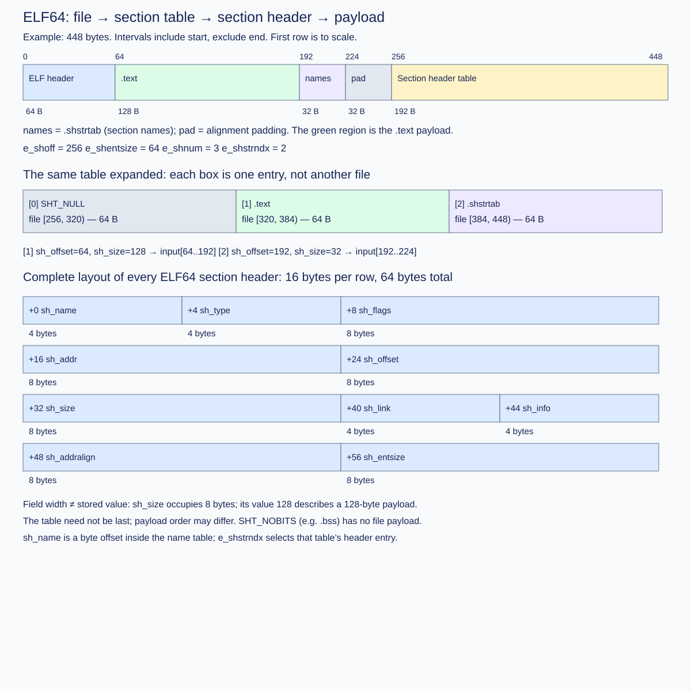

# Class 0: ELF Input Boundary

Implementation: [`src/elf_header.rs`](src/elf_header.rs).


Implement C0.1–C0.3 in [`src/elf_header.rs`](src/elf_header.rs). The input is a byte slice; the outputs are a
validated ELF64 header and bounded section-header slices. No CLI, ELF writer, or
test framework implementation is required.

## Format contract

Accept ELF64, little-endian, x86-64, ET_REL, version 1. The ELF header and each
section-header entry occupy 64 bytes. This stage requires a nonempty ordinary
section table and a nonzero section-name-table index strictly below the section
count. Extended numbering is unsupported. Class1 validates section contents.

Ordinary numbering ends before `SHN_LORESERVE = 0xff00`. At or above that
count, ELF stores zero in `e_shnum` and the actual count in section zero's
`sh_size`. This stage does not decode that extended representation. It rejects
zero counts, reserved count values, and a zero or out-of-range name-table index
with `UnsupportedExtendedNumbering`; a rejected zero can also mean an absent
table rather than an extended one. See the [gABI ELF header](https://gabi.xinuos.com/elf/02-eheader.html).

| Byte offset | Width | Field and requirement |
|---|---|---|
| 0 | 4 | Magic `7f 45 4c 46` |
| 4 / 5 / 6 | 1 each | Class=2, data=1, identification version=1 |
| 16 | 2 | e_type=1 |
| 18 | 2 | e_machine=62 |
| 20 | 4 | e_version=1 |
| 40 | 8 | e_shoff |
| 52 | 2 | e_ehsize=64 |
| 58 | 2 | e_shentsize=64 |
| 60 | 2 | e_shnum, `0 < count < 0xff00` |
| 62 | 2 | e_shstrndx, 0 < index < e_shnum |

The table follows byte order. Diagnostic priority follows the API contract:
length, magic, class, endian, identification version, `e_version`, `e_type`,
`e_machine`, `e_ehsize`, `e_shentsize`, numbering, then the section-table range.
If several conditions fail, return the error for the first failed check in this
order. Decode the entire field: checking its first byte alone can accept an
unsupported value whose remaining bytes are nonzero.

## Tasks and assessment groups

- **C0.1 (30 points):** Checked byte ranges. Addition overflow is RangeOverflow;
  any other range beyond the file is OutOfBounds. An empty range at EOF is valid.
- **C0.2 (45 points):** Decode and validate the header in the documented order.
  A short header is Truncated; a truncated section table is OutOfBounds.
- **C0.3 (25 points):** Select one section header with checked indexing, including
  when the caller supplies a different input slice or a fabricated Header.

Use explicit little-endian decoding, not a cast of the file onto a Rust struct.
Check arithmetic before converting to usize or indexing. Invalid input must
return an Error, not panic. Public signatures and provided tests are fixed;
private helper functions and additional student tests are allowed.

## Validation

```sh
cargo test -p class0
cargo test -p class0 --release
```

The tests cover valid headers, truncation at every header byte, table truncation,
unsupported formats, range overflow, empty ranges, and section indexing. The
starter compiles and fails behavior tests at its TODOs. All groups must pass to
complete the stage; group weights indicate partial progress only.

## Design questions for your implementation notes

Explain why checking `offset <= len` is insufficient, and why converting a u64
file offset to usize before validating it can change its meaning. These notes
support code review; they are not another set of implementation exercises.

For grouped local feedback, run `python3 scripts/grade.py class0` from the repository root.

## Observable validation order

When multiple defects coexist, return the first error in this sequence:

1. Minimum 64-byte input length.
2. Magic, class, byte order, identification version (offset 6).
3. Header version (offset 20), type, machine.
4. ELF header size, section-header entry size.
5. Section count and section-name-table index.
6. The complete section-table byte range.

This is the course API's deterministic diagnostic policy, not an ELF requirement
that parsers diagnose invalid files in this order. Reading a field and validating
its value are separate operations. In particular, do not check the table range
before checking its numbering. A bad name-table index wins over an overflowing
or out-of-file table offset.

For `checked_slice`, first check u64 addition; only then compare the end with the
file length. Thus `(u64::MAX, 1)` is RangeOverflow even for an empty file, while
`(u64::MAX, 0)` is OutOfBounds. Widen a section count or index to u64 **before**
multiplying by 64: 1024 entries occupy 65536 bytes, which does not fit in u16.

For `section_header`, check `index < section_count` before offset arithmetic.
Bytes following the table do not make an out-of-table index valid. The returned
slice contains exactly one 64-byte header, not the section payload.

## File coordinates and section coordinates



An ELF object is one file containing one section-header table. The table has
`section_count` entries, each describing one section. `section_offset` locates
the table in the file. `section_names_index` selects the entry describing the
section-name string table; it is an entry number, not a byte offset.

For the 448-byte example, all intervals below are half-open:

| File bytes | Region | Bytes |
|---|---|---|
| [0, 64) | ELF header | 64 |
| [64, 192) | .text payload (machine instructions) | 128 |
| [192, 224) | .shstrtab payload (NUL-terminated names) | 32 |
| [224, 256) | Padding | 32 |
| [256, 320) | Section-header entry 0: SHT_NULL | 64 |
| [320, 384) | Section-header entry 1: describes .text | 64 |
| [384, 448) | Section-header entry 2: describes .shstrtab | 64 |

Here `e_shoff=256`, `e_shnum=3`, and `e_shstrndx=2`. Entry 1's `sh_offset=64`
and `sh_size=128` select the payload [64,192). Those two fields themselves are
8 bytes each, at offsets +24 and +32 within entry 1. Every entry uses the same
ELF64 layout; entry 0 has special null semantics. The table need not be at EOF,
and payload order need not follow table order. SHT_NOBITS describes memory space
without occupying payload bytes in the file. Class1 handles these distinctions.

The table can exceed the total payload size in a tiny object: three entries
already take 192 bytes. These sizes do not imply a typical real-world ratio.

## Method map: what each function establishes

Little-endian decoding helpers make field width and byte order explicit at each
call site. ELF64 uses 64-bit offsets and sizes, but its type, machine, version,
and table-count fields have other widths. Decode the full field rather than
testing only its lowest byte.

`checked_slice(input, offset, size)` is the safety boundary for the entire linker. It proves `offset + size` in `u64` before converting either value to `usize`. `RangeOverflow` means the arithmetic itself cannot represent the requested interval; `OutOfBounds` means the interval is representable but outside this file. A zero-length interval at `input.len()` is valid. Do not replace this with `offset <= len`: that checks a start, not the complete interval.

`parse_header` answers one question: “may the later stages interpret these bytes as the ELF64 ET_REL format used by this course?” It validates fields in the documented order, then validates the complete section-header table. `e_shentsize == 64` is the size of one **entry**, not the size of the table; the table size is `e_shentsize * e_shnum`. `e_shstrndx` is an entry index, not a byte offset.

`section_header` converts an entry index into exactly one 64-byte file range. Check `index < section_count` before `section_offset + index * 64`, and check the supplied input again because a caller may pair a fabricated header with a shorter byte slice. It returns a descriptor, never the section payload; `sh_offset` and `sh_size` are the next lookup.

### Implementation path

1. Implement `checked_slice`; test overflow, EOF-empty, and truncated ranges.
2. Decode the fixed-width header fields with the little-endian helpers.
3. Validate numbering before the table range, then use `checked_slice` for the table.
4. Implement indexed entry selection without assuming the table is at EOF.

## Snapshot boundary

This directory is a complete, independently buildable project. Earlier modules
contain reference implementations; this assignment owns `src/elf_header.rs`.
The public interfaces stay stable so you can substitute your own earlier modules.

The supplied `read_u16`, `read_u32`, and `read_u64` helpers decode little-endian
integers through your `checked_slice` implementation. Keep these public helpers
when carrying your module into another snapshot; later modules use them. The
three assigned tasks remain range checking, header validation, and table indexing.
